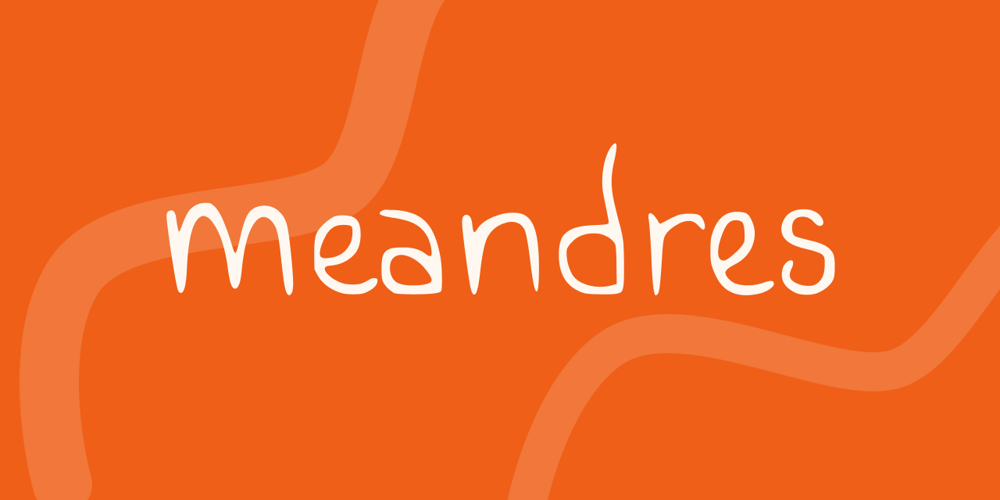

# Méandres

Une typographie manuscrite, créée à la main par Oriane Bruant, libre et gratuite pour tous.

A handwritten typeface, hand-drawn by Oriane Bruant, free for everyone to use.



🌐 **Page de présentation / Specimen page:** https://orianebruant.github.io/meandres-font/

## Télécharger / Download

➡️ [**Dernière version / Latest release**](../../releases/latest)

Fichiers fournis / Files included:

- `Meandres-Regular.ttf` : pour installer la police sur un ordinateur / for desktop use
- `Meandres-Regular.woff2` : pour les sites web / for websites

## Structure du dépôt

- `Meandres-Regular.ttf`, `Meandres-Regular.woff2` : fichiers de la police
- `OFL.txt` : licence
- `index.html` : page de présentation (GitHub Pages)
- `meandres_font.png` : image d'aperçu de la police
- `sources/` : fichiers de travail pour retravailler la police, dont la feuille de glyphes dessinés [`Meandres_glyphes.svg`](sources/Meandres_glyphes.svg)

## Utilisation / License

Méandres est distribuée sous licence **SIL Open Font License 1.1** (voir [OFL.txt](OFL.txt)).

Vous pouvez l'utiliser gratuitement, à titre personnel ou commercial (affiches, logos, livres, sites, produits...), la partager et la modifier, à condition de conserver la licence avec la police. La police ne peut pas être vendue seule.

You can use it for free, personally or commercially, share it and modify it, as long as the license stays with the font. The font cannot be sold by itself.

## Caractères disponibles / Characters

- Lettres A–Z, a–z et lettres accentuées françaises : é è ê ë à â ç î ï ô ù û ü œ Œ
- Chiffres : 0 1 2 3 4 5 6 7 8 9
- Ponctuation et symboles : . , ; : ! ? ' ’ “ ” « » ( ) - – — … + = # * _ € $

## Utiliser la police sur un site web

```css
@font-face {
  font-family: "Méandres";
  src: url("Meandres-Regular.woff2") format("woff2"),
       url("Meandres-Regular.ttf") format("truetype");
  font-display: swap;
}

body {
  font-family: "Méandres", cursive;
}
```

## Historique des versions / Changelog

- **1.005** (novembre 2026) : ajout de `# * $ _`, nouveaux dessins pour `( ) € “ ”`.
- **1.004** (novembre 2026) : espacement des lettres recalculé selon la forme de chaque lettre et crénage par paires (AV, To, Ty, fl...).
- **1.003** (novembre 2026) : ajout des chiffres, des lettres accentuées manquantes et de la ponctuation complète.
- **1.002** (novembre 2026) : première version, créée avec Calligraphr.

## Contact

Oriane Bruant, oriane.bruant@gmail.com

Copyright 2026 The Meandres Project Authors
